> **ARCHIVED — superseded on 2026-11-09 by `VIGILSYSTEM_MASTER_CONTEXT.md` v1.0. Kept for history only. Do not implement from this document.**
>
> Original location: Claude Project: `VigilSystem – Class Diagram (Design Phase).md` · Document date: 2 Nov 2026 · Superseded by: Master Context §E.3.
> The text below this box is an unchanged copy of the original.

---

# VigilSystem – Class Diagram (Design Phase)

Nov 2, 2026 · @David · Group 8 · David Cardoso (PG63873) · Ana Sofia Cunha (A107017)

## Purpose and context

The analysis-phase class diagram was replaced by a new one that matches the agreed design architecture: nine pthreads, one Event Queue, one custom PWM driver and mainline interfaces for everything else. The new diagram is written in PlantUML so it can be regenerated for the slide and the report.

The old diagram no longer matched the design in four ways:

- **Wrong drivers.** It showed `KeypadDriver`, `GpioDriver`, `LedDriver`, `BuzzerDriver` and `UpsHatDriver`. The design has exactly one custom kernel driver (`/dev/vigil_pwm`); keypad, button, IR, MQ-2 and RGB LED use libgpiod, and the INA219 uses i2c-dev.
- **Wrong threads.** It had `SensorMonitorThread` (split into `IRSensorsThread` and `MQ2SensorThread`) and no `OutputThread`, `AlarmControllerThread` or `SupervisorThread`.
- **A central god class.** `VigilSystemController`, `DelayTimer` and `AlarmActuator` held logic that now lives in `AlarmControllerThread` (FSMs and timers) and `OutputThread` (tones and LEDs).
- **No FSM states.** The four state machines and their states were not defined anywhere in the class diagram.

The work had two rounds: a first version (v1) and a review that found eight issues, fixed in v2. Section "Review round" lists each issue and its fix.

## Summary of decisions

| Topic | Decision | Why |
| --- | --- | --- |
| Removed classes | `VigilSystemController`, `SensorMonitorThread`, `DelayTimer`, `AlarmActuator`, `LedDriver`, `KeypadDriver`, `GpioDriver`, `BuzzerDriver`, `UpsHatDriver` | Not part of the agreed architecture; their roles moved to the classes below |
| Thread base class | Abstract `WorkerThread` (pthread wrapper: `start()`, `stop()`, abstract `run()`, `heartbeat()`); the 8 worker threads extend it | Gives `SupervisorThread` one type to monitor ("1 o-- 8") and one place for the heartbeat logic |
| Supervision | `SupervisorThread` is a pthread but not a `WorkerThread`; it owns the hardware watchdog fd | It must not monitor itself; the watchdog covers it |
| Controller | `AlarmControllerThread` holds the 4 FSM states, the epoll fd, 4 timerfds (exit 60 s, entry 30 s, silence 10 min, lockout 5 min), the shared wrong-PIN counter and the cached PIN hash | Single owner of all system logic and timing |
| Remote commands | Separate handlers: `handleRemoteArm()`, `handleRemoteDisarm(pin)`, `handleChangePin(pin, newPin)` | Every remote command has a visible handler; `get_events` goes Network → Storage directly |
| Inter-thread queues | `EventQueue` (queue + mutex + condition variable + eventfd) and a template `CommandQueue<T>` used by Output, Storage and Network | Matches the agreed one-event-queue, one-command-queue-per-consumer design |
| Hardware access | User-space wrappers: `PwmDevice`, `GpioLines`, `Ina219`, `MqttClient`, `Database` | Only `PwmDevice` talks to a custom driver; the rest wrap mainline interfaces or libraries |
| PWM command | `writeCommand(channel, patternId, frequencyHz, dutyPercent, enable)` | Patterns are stepped in the kernel with hrtimers, so the command must name the pattern |
| `GpioLines` | One object = one libgpiod line request (one or more lines) | Lets multiplicities show how many requests each thread holds |
| Alerts | Passed as `Event` (alert JSON in `payload`) | Avoids an extra `Alert` class |
| `EventType` | Queue events plus FSM-internal events, split by two separators | Every event name used on the FSM slides is defined in the class diagram |
| Detail level | Only key attributes and design-relevant methods; private helpers and per-thread `run()` overrides removed | Fits one 4:3 slide at readable size |

## Classes and responsibilities

The diagram has 18 classes and 5 enumerations, in three groups: threads, queues and user-space hardware access.

**Threads**

| Class | Key members | Responsibility |
| --- | --- | --- |
| `WorkerThread` (abstract) | `tid`, `running`, `start()`, `stop()`, abstract `run()`, `heartbeat()` | Base of the 8 worker threads |
| `SupervisorThread` | `wdtFd` (/dev/watchdog), `onHeartbeat()`, `restartThread()`, `feedWatchdog()` | Restarts a hung thread; feeds bcm2835\_wdt |
| `LocalInputThread` | `pinBuffer`, `scanPeriodMs = 15` | Keypad scan and arm button; pushes `EVT_KEY_DIGIT`, `EVT_PIN_SUBMIT`, `EVT_BUTTON_PRESS` |
| `IRSensorsThread` | `lastState[2]` | Blocking edge events on GPIO16/20; pushes `EVT_MOTION_DETECTED(id)` |
| `MQ2SensorThread` | `warmUpS`, `requiredReads` | Warm-up and N consecutive reads on GPIO21; pushes `EVT_SMOKE_DETECTED` |
| `PowerMonitorThread` | `pollPeriodMs = 1000`, `hysteresisSamples = 3` | INA219 polling; pushes power and battery events |
| `AlarmControllerThread` | 4 FSM states, `epfd`, 4 timerfds, `wrongPinCount`, `pinHash`, event, timer and command handlers | Runs the 4 FSMs; sends commands to Output, Storage and Network |
| `OutputThread` | `cmdQueue: CommandQueue<OutputCmd>` | Only client of `/dev/vigil_pwm`; drives the RGB LED |
| `StorageThread` | `cmdQueue`, `saveEvent`, `loadPinHash`, `savePinHash`, `insertPendingAlert`, `getPendingAlerts`, `markSent(id)`, `getEventsSince(eventId)` (max 20) | SQLite access, outbox |
| `NetworkMQTTThread` | `cmdQueue`, `backoffS` (1 s → 60 s), `maxResendPerS = 5`, `publishAlert`, `publishStatus`, `resendPending` | MQTT 5 over TLS to EMQX; pushes network and remote-command events |

**Queues and messages**

| Class | Key members | Responsibility |
| --- | --- | --- |
| `Event` | `type`, `sourceId`, `timestamp`, `payload` | One event or alert |
| `EventQueue` | `std::queue`, mutex, condition variable, `efd` (eventfd), `push()`, `tryPop()`, `getFd()` | All producers → `AlarmControllerThread` (epoll on the eventfd) |
| `CommandQueue<T>` | `std::queue<T>`, mutex, condition variable, `push()`, blocking `pop()` | One per consumer thread (`OutputCmd`, `StorageCmd`, `NetCmd`) |

**User-space hardware access**

| Class | Interface | Key methods |
| --- | --- | --- |
| `PwmDevice` | Custom driver `/dev/vigil_pwm` (mutex inside) | `writeCommand(channel, patternId, frequencyHz, dutyPercent, enable)` |
| `GpioLines` | libgpiod line request | `requestLines()`, `get()`, `set()`, `waitEdge()` |
| `Ina219` | i2c-dev, `/dev/i2c-1`, address `0x42` | `readBusVoltage()`, `readCurrent()` |
| `MqttClient` | Eclipse Paho C++ (`mqtt::async_client`) | `connect()`, `publish(topic, payload, qos, retain)`, `subscribe()` |
| `Database` | SQLite (`sqlite3*`) | `open()`, `exec()`, `prepare()` |

## Relationships and multiplicities

Every multiplicity counts objects, not wires: one `GpioLines` object is one libgpiod line request, which can hold several lines.

| From | Relation | To | Multiplicity | Label / meaning |
| --- | --- | --- | --- | --- |
| 8 worker threads | Generalization | `WorkerThread` | – | Merged into one triangle (`groupInheritance 2`) |
| `SupervisorThread` | Aggregation | `WorkerThread` | 1 → 8 | Heartbeats / restart |
| LocalInput, IR, MQ-2, Power, Network threads | Dependency | `EventQueue` | – | push |
| `AlarmControllerThread` | Association | `EventQueue` | 1 → 1 | Consumes (epoll on eventfd) |
| `EventQueue` | Aggregation | `Event` | 1 → 0..\* | Queued events |
| `Event` | Association | `EventType` | – | Event type |
| `AlarmControllerThread` | Association | Output / Storage / Network threads | 1 → 1 each | `OutputCmd`, `StorageCmd`, `NetCmd` |
| `NetworkMQTTThread` | Dependency | `StorageThread` | – | Outbox, `get_events` |
| `LocalInputThread` | Composition | `GpioLines` | 1 → 2 | Inputs (rows + button), outputs (columns) |
| `IRSensorsThread` | Composition | `GpioLines` | 1 → 1 | 2 lines (GPIO16, GPIO20) |
| `MQ2SensorThread` | Composition | `GpioLines` | 1 → 1 | 1 line (GPIO21) |
| `OutputThread` | Composition | `GpioLines` | 1 → 1 | RGB (3 lines) |
| `OutputThread` | Composition | `PwmDevice` | 1 → 1 | 2 channels: speaker, red LED |
| `PowerMonitorThread` | Composition | `Ina219` | 1 → 1 | – |
| `StorageThread` | Composition | `Database` | 1 → 1 | – |
| `NetworkMQTTThread` | Composition | `MqttClient` | 1 → 1 | – |

`CommandQueue<T>` has no association arrows; it is linked through the typed `cmdQueue` attributes of the three consumer threads, which keeps the slide free of three more crossing lines.

## Enumerations

The four FSM enumerations use exactly the agreed state names; `EventType` defines every event the FSM slides use, split by where the event comes from.

| Enumeration | Values |
| --- | --- |
| `OperationalState` | DISARMED, EXIT\_DELAY, ARMED, ENTRY\_DELAY, INTRUSION\_ALARM |
| `FireState` | NORMAL, FIRE\_ALARM, SILENCED |
| `PowerState` | AC\_POWERED, BATTERY\_MODE, LOW\_BATTERY, SHUTDOWN (final) |
| `NetState` | NET\_CONNECTED, NET\_LOST |

**`EventType`, pushed through `EventQueue`:** EVT\_KEY\_DIGIT, EVT\_PIN\_SUBMIT, EVT\_BUTTON\_PRESS, EVT\_MOTION\_DETECTED, EVT\_SMOKE\_DETECTED, EVT\_POWER\_LOST, EVT\_POWER\_RESTORED, EVT\_BATTERY\_LOW, EVT\_BATTERY\_CRITICAL, EVT\_NET\_DISCONNECTED, EVT\_NET\_RESTORED, EVT\_REMOTE\_ARM, EVT\_REMOTE\_DISARM, EVT\_REMOTE\_CHANGE\_PIN.

**`EventType`, raised inside `AlarmControllerThread`:** EVT\_SYSTEM\_STARTUP, EVT\_PIN\_CORRECT, EVT\_PIN\_WRONG, EVT\_EXIT\_DELAY\_TIMEOUT, EVT\_ENTRY\_DELAY\_TIMEOUT, EVT\_SMOKE\_SILENCE\_TIMEOUT, EVT\_LOCKOUT\_TIMEOUT, EVT\_RETRY\_TIMER.

Why the split: timer expiries arrive as timerfd readiness on the same epoll, and `onTimerExpired(fd)` turns each into an `Event` for `handleEvent()`. `EVT_PIN_SUBMIT` is turned into `EVT_PIN_CORRECT` or `EVT_PIN_WRONG` after `verifyPin()`. So the FSMs see one event type, but only the first group travels through the queue.

`EVT_REMOTE_GET_EVENTS` was removed: `get_events` goes straight from `NetworkMQTTThread` to `StorageThread` and never enters the `EventQueue`.

## Review round: v1 → v2

The v1 review found two blocking issues, four smaller inconsistencies and two cosmetic ones; all eight are fixed in v2.

| # | Issue in v1 | Fix in v2 | Why |
| --- | --- | --- | --- |
| 1 | Inheritance only stated in a note; no generalization arrows | 8 arrows to `WorkerThread`, merged into one shared point with `skinparam groupInheritance 2` | In UML a note does not replace a relationship |
| 2 | `EventType` missed the events the FSMs use | Added `EVT_PIN_CORRECT`, `EVT_PIN_WRONG`, the 3 timeouts, `EVT_RETRY_TIMER`, `EVT_SYSTEM_STARTUP` (+ `EVT_LOCKOUT_TIMEOUT`), with separators by source | FSM slides must not use names the class diagram never defines |
| 3 | `writeCommand()` had no pattern parameter | Added `patternId: uint8_t`; `OutputThread` only forwards it | Tone and blink patterns run in the kernel as steps |
| 4 | `IRSensorsThread 1 → 2 GpioLines` meant two requests | Changed to `1 → 1`, label "2 lines (GPIO16, GPIO20)"; `LocalInputThread 1 → 2` kept, label explains inputs vs outputs | One line request covers both IR lines |
| 5 | Only Remote Disarm had a handler | Added `handleRemoteArm()` and `handleChangePin(pin, newPin)` | Every remote command needs a visible handler |
| 6 | `CommandQueue<T>` used but never shown | Added the template class (queue, mutex, condition variable, `push()`, `pop()`) | Types used in attributes must be defined |
| 7 | Enumerations package took about a quarter of the image; long crossing lines | Enums in one row along the bottom; `GpioLines` placed under the sensor threads; `Event` placed left of `EventQueue`, above `EventType` | Fewer crossings, less empty space |
| 8 | Text too small for a 4:3 slide | `skinparam dpi 200`; private helpers (`onEdge`, `scanKeypad`, `debounceButton`, `estimateBattery`) and `run()` overrides removed | Helpers add no design information |

## Layout and slide rendering

The diagram is laid out in four rows so the arrows mostly run top to bottom:

1. `SupervisorThread` and `WorkerThread`.
2. The 8 worker threads, in order: LocalInput, IR, MQ-2, Power, AlarmController, Output, Storage, Network.
3. `GpioLines`, `Ina219`, `Event`, `EventQueue`, `CommandQueue<T>`, `PwmDevice`, `Database`, `MqttClient`.
4. The 5 enumerations in one row.

Hidden links (`-[hidden]right-`) fix the order inside rows 2–4. Rendering settings: `dpi 200`, default font 10 pt, class names 11 pt, `nodesep 18`, `ranksep 40`, `hide empty members`.

If the single row of 8 threads makes the image too wide for the slide, change the inheritance arrows of `AlarmControllerThread`, `OutputThread`, `StorageThread` and `NetworkMQTTThread` to `<|---`. They move to a second row and the merged triangle still works.

## Open points

- [ ] **`EVT_LOCKOUT_TIMEOUT`:** added because the 5 min lockout timer needs an expiry event. Remove it if the FSM slides treat the lockout only as a guard condition.
- [ ] **`EVT_RETRY_TIMER` owner:** the reconnect backoff (1 s → 60 s) lives in `NetworkMQTTThread`. If this timer belongs there, move the event out of the "raised inside AlarmControllerThread" group.
- [ ] **Render check:** confirm the 8-thread row fits the 4:3 slide at `dpi 200`; otherwise use the two-row variant above.
- [ ] **Consistency with other slides:** the FSM, flowchart and task-priority slides must use the same class, state and event names as this diagram.

## Final PlantUML source (v2)

```plantuml
@startuml VigilSystem_ClassDiagram
title VigilSystem – Class Diagram (Design Phase)

skinparam dpi 200
skinparam groupInheritance 2
skinparam classAttributeIconSize 0
skinparam shadowing false
skinparam defaultFontSize 10
skinparam classFontSize 11
skinparam nodesep 18
skinparam ranksep 40
hide empty members

' ===================== Row 0: supervision =====================
class SupervisorThread <<pthread>> {
  -wdtFd: int  {/dev/watchdog}
  +onHeartbeat(threadId: int): void
  -restartThread(threadId: int): void
  -feedWatchdog(): void
}

abstract class WorkerThread <<pthread>> {
  #tid: pthread_t
  #running: std::atomic<bool>
  +start(): void
  +stop(): void
  #{abstract} run(): void
  #heartbeat(): void
}

' ===================== Row 1: the eight worker threads =====================
class LocalInputThread {
  -pinBuffer: std::string
  -scanPeriodMs: int = 15
}

class IRSensorsThread {
  -lastState: bool[2]
}

class MQ2SensorThread {
  -warmUpS: int
  -requiredReads: int
}

class PowerMonitorThread {
  -pollPeriodMs: int = 1000
  -hysteresisSamples: int = 3
}

class AlarmControllerThread {
  -opState: OperationalState
  -fireState: FireState
  -powerState: PowerState
  -netState: NetState
  -epfd: int  {epoll}
  -exitTimerFd: int  {timerfd, 60 s}
  -entryTimerFd: int  {timerfd, 30 s}
  -silenceTimerFd: int  {timerfd, 10 min}
  -lockoutTimerFd: int  {timerfd, 5 min}
  -wrongPinCount: int
  -pinHash: std::string
  -handleEvent(e: Event): void
  -onTimerExpired(fd: int): void
  -verifyPin(pin: std::string): bool
  -handleRemoteArm(): void
  -handleRemoteDisarm(pin: std::string): void
  -handleChangePin(pin: std::string, newPin: std::string): void
}

class OutputThread {
  -cmdQueue: CommandQueue<OutputCmd>
}

class StorageThread {
  -cmdQueue: CommandQueue<StorageCmd>
  +saveEvent(event: Event): int
  +loadPinHash(): std::string
  +savePinHash(hash: std::string): bool
  +insertPendingAlert(alert: Event): int
  +getPendingAlerts(): std::vector<Event>
  +markSent(id: int): void
  +getEventsSince(eventId: int): std::vector<Event>  {max 20}
}

class NetworkMQTTThread {
  -cmdQueue: CommandQueue<NetCmd>
  -backoffS: int  {1 s → 60 s}
  -maxResendPerS: int = 5
  +publishAlert(alert: Event): void
  +publishStatus(): void
  -resendPending(): void
}

' ===================== Row 2: queues and user-space hardware access =====================
class GpioLines {
  -chip: gpiod_chip*
  -request: gpiod_line_request*
  +requestLines(offsets: std::vector<int>, dir: int, bias: int): bool
  +get(offset: int): int
  +set(offset: int, value: int): void
  +waitEdge(timeoutNs: int64_t): bool
}

class Ina219 {
  -fd: int  {/dev/i2c-1}
  -address: uint8_t = 0x42
  +readBusVoltage(): float
  +readCurrent(): float
}

class Event {
  +type: EventType
  +sourceId: int
  +timestamp: time_t
  +payload: std::string
}

class EventQueue {
  -queue: std::queue<Event>
  -mtx: std::mutex
  -cv: std::condition_variable
  -efd: int  {eventfd}
  +push(e: Event): void
  +tryPop(out e: Event): bool
  +getFd(): int
}

class CommandQueue<T> {
  -queue: std::queue<T>
  -mtx: std::mutex
  -cv: std::condition_variable
  +push(cmd: T): void
  +pop(): T  {blocking}
}

class PwmDevice {
  -fd: int  {/dev/vigil_pwm}
  -mtx: std::mutex
  +writeCommand(channel: uint8_t, patternId: uint8_t,\n  frequencyHz: uint32_t, dutyPercent: uint8_t,\n  enable: bool): int
}

class Database {
  -db: sqlite3*
  +open(path: std::string): bool
  +exec(sql: std::string): bool
  +prepare(sql: std::string): sqlite3_stmt*
}

class MqttClient {
  -client: mqtt::async_client
  +connect(): bool
  +publish(topic: std::string, payload: std::string,\n  qos: int, retain: bool): void
  +subscribe(topic: std::string, qos: int): void
}

' ===================== Row 3: enumerations =====================
enum EventType {
  .. pushed through EventQueue ..
  EVT_KEY_DIGIT, EVT_PIN_SUBMIT, EVT_BUTTON_PRESS
  EVT_MOTION_DETECTED, EVT_SMOKE_DETECTED
  EVT_POWER_LOST, EVT_POWER_RESTORED
  EVT_BATTERY_LOW, EVT_BATTERY_CRITICAL
  EVT_NET_DISCONNECTED, EVT_NET_RESTORED
  EVT_REMOTE_ARM, EVT_REMOTE_DISARM, EVT_REMOTE_CHANGE_PIN
  .. raised inside AlarmControllerThread (timerfd, PIN check) ..
  EVT_SYSTEM_STARTUP
  EVT_PIN_CORRECT, EVT_PIN_WRONG
  EVT_EXIT_DELAY_TIMEOUT, EVT_ENTRY_DELAY_TIMEOUT
  EVT_SMOKE_SILENCE_TIMEOUT, EVT_LOCKOUT_TIMEOUT
  EVT_RETRY_TIMER
}

enum OperationalState {
  DISARMED
  EXIT_DELAY
  ARMED
  ENTRY_DELAY
  INTRUSION_ALARM
}

enum FireState {
  NORMAL
  FIRE_ALARM
  SILENCED
}

enum PowerState {
  AC_POWERED
  BATTERY_MODE
  LOW_BATTERY
  SHUTDOWN
}

enum NetState {
  NET_CONNECTED
  NET_LOST
}

' ===================== Generalization (merged into one shared point) =====================
WorkerThread <|-- LocalInputThread
WorkerThread <|-- IRSensorsThread
WorkerThread <|-- MQ2SensorThread
WorkerThread <|-- PowerMonitorThread
WorkerThread <|-- AlarmControllerThread
WorkerThread <|-- OutputThread
WorkerThread <|-- StorageThread
WorkerThread <|-- NetworkMQTTThread

SupervisorThread "1" o-right- "8" WorkerThread : heartbeats /\nrestart

' ===================== Event flow =====================
LocalInputThread ..> EventQueue : push
IRSensorsThread ..> EventQueue : push
MQ2SensorThread ..> EventQueue : push
PowerMonitorThread ..> EventQueue : push
NetworkMQTTThread ..> EventQueue : push
AlarmControllerThread "1" --> "1" EventQueue : consumes\n(epoll on eventfd)
EventQueue "1" o-left- "0..*" Event
Event --> EventType

' ===================== Commands =====================
AlarmControllerThread "1" -right-> "1" OutputThread : OutputCmd
AlarmControllerThread "1" -right-> "1" StorageThread : StorageCmd
AlarmControllerThread "1" -right-> "1" NetworkMQTTThread : NetCmd
NetworkMQTTThread .left.> StorageThread : outbox,\nget_events

' ===================== Hardware access =====================
LocalInputThread "1" *-- "2" GpioLines : inputs (rows + button),\noutputs (columns)
IRSensorsThread "1" *-- "1" GpioLines : 2 lines\n(GPIO16, GPIO20)
MQ2SensorThread "1" *-- "1" GpioLines : 1 line (GPIO21)
OutputThread "1" *-- "1" GpioLines : RGB (3 lines)
OutputThread "1" *-- "1" PwmDevice : 2 channels:\nspeaker, red LED
PowerMonitorThread "1" *-- "1" Ina219
StorageThread "1" *-- "1" Database
NetworkMQTTThread "1" *-- "1" MqttClient

' ===================== Layout hints =====================
LocalInputThread -[hidden]right- IRSensorsThread
IRSensorsThread -[hidden]right- MQ2SensorThread
MQ2SensorThread -[hidden]right- PowerMonitorThread
PowerMonitorThread -[hidden]right- AlarmControllerThread
EventQueue -[hidden]right- CommandQueue
CommandQueue -[hidden]right- PwmDevice
EventType -[hidden]right- OperationalState
OperationalState -[hidden]right- FireState
FireState -[hidden]right- PowerState
PowerState -[hidden]right- NetState
@enduml
```

