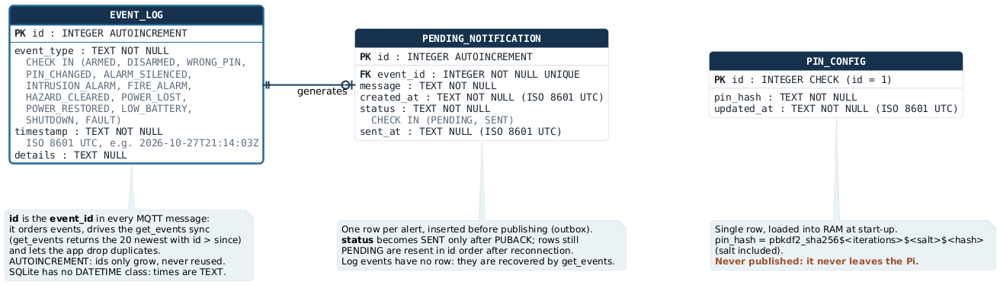

> **ARCHIVED — superseded on 2026-11-09 by `VIGILSYSTEM_MASTER_CONTEXT.md` v1.0. Kept for history only. Do not implement from this document.**
>
> Original location: Claude Project: `VigilSystem – Design Deck Data Storage, ERD and Cloud Architecture Updates.md` · Document date: 2 Nov 2026 · Superseded by: Master Context §E.5, §I.
> The text below this box is an unchanged copy of the original.

---

# VigilSystem – Design Deck: Data Storage, ERD and Cloud Architecture Updates

Nov 2, 2026 · @David

## Purpose and scope

Slides 17 (Data Storage Specification), 18 (Database ERD) and 19 (Cloud Architecture) of the Design deck were updated to follow "VigilSystem – Design Deck: Changes To Make" (Oct 31, 2026). This doc records each change, why it was made, and the new diagram sources.

- Slides 17 and 18 are PlantUML diagrams. Their new code is below; both compile in PlantUML 1.2024.7 and keep the current look (colours, notes, layout).
- Slide 19 is a draw.io diagram. It was redrawn as an editable file, `VigilSystem_Cloud_Architecture.drawio`, to export as PNG and replace the slide image.
- Changes marked **(optional)** are not required by the Changes To Make doc. They keep these slides consistent with other decisions in it and can be removed.

No other slide was changed. Slide numbers refer to the current 61-slide Design deck.

## Summary of changes

Twelve required changes and eight optional ones, across three slides.

| Slide | Change | Source | Required |
| --- | --- | --- | --- |
| 17 | Pi box: PENDING\_NOTIFICATION is an outbox for every alert, PENDING until PUBACK | 1.2.1 | Yes |
| 17 | App box: `client_id` generated at first launch | 1.1.4 | Yes |
| 17 | App box: "max 20 alerts and events" (no more "\~20") | 1.2.5 | Yes |
| 17 | PIN\_CONFIG line: salted PBKDF2-SHA256 hash | 1.2.6 | Optional |
| 17 | `connection`: also clean shutdown with reason | 1.1.1 | Optional |
| 17 | `cmd`: "never retained or stored" | 1.1.7 | Optional |
| 17 | Offline queue kept per `client_id` | 1.1.4 | Optional |
| 18 | `event_type` CHECK: add `LOW_BATTERY`, `SHUTDOWN`, `FAULT` | 1.1.1, 1.1.3 | Yes |
| 18 | EVENT\_LOG note: get\_events returns the 20 newest with id > since | 1.2.4 | Yes |
| 18 | PENDING\_NOTIFICATION note: outbox rule | 1.2.1 | Yes |
| 18 | PIN\_CONFIG note: `pbkdf2_sha256$<iterations>$<salt>$<hash>` | 1.2.6 | Yes |
| 18 | `UNIQUE` on `event_id` | — | Optional |
| 18 | `CHECK (id = 1)` on PIN\_CONFIG | — | Optional |
| 19 | New "ONT / ISP modem" box; cloud arrows start there | 1.1.8 | Yes |
| 19 | Dashed box "Recommended: small UPS" around router + ONT | 1.1.8 | Yes |
| 19 | Phone path through "Wi-Fi or 4G/5G → Internet" | 1.1.8 | Yes |
| 19 | Broker subtitle: "retained messages + per-client offline queues" | 1.1.8 | Yes |
| 19 | Security note: TLS is hop-by-hop | 1.1.7 | Yes |
| 19 | Wi-Fi label "802.11n/ac · WPA2-PSK" | 1.1.10 | Optional |
| 19 | Right box renamed "Cloud / Internet"; "MQTT 5" spelling | — | Optional |

## Slide 17 – Data Storage Specification

The slide now shows PENDING\_NOTIFICATION as an outbox for every alert and lists the app's generated `client_id`.

**Why each change was made:**

- **Outbox (1.2.1).** The old text "alerts while offline" implied a row is created only when the broker is down. An alert published just before an undetected link loss would then be lost. Now every alert gets a PENDING row before publishing and becomes SENT only after PUBACK.
- **client\_id (1.1.4).** With a fixed client ID, two phones would take over each other's broker session. Each installation now generates `vigil-app-<8 hex>` once and stores it in `shared_preferences`; the username stays `vigil-app`, so the ACL does not change.
- **Max 20 (1.2.5).** "\~20" contradicted the GUI doc and the tests, which use exactly 20.
- **Optional consistency edits.** Salted PBKDF2-SHA256 (1.2.6), the clean shutdown `connection` message with a reason (1.1.1), `cmd` never retained or stored (1.1.7), and one offline queue per `client_id`.

In the code, the client ID is written `vigil-app-XXXXXXXX (8 hex)` so PlantUML cannot mistake `<8 hex>` for a formatting tag.

```plantuml
@startuml data_storage
left to right direction
skinparam defaultFontName "DejaVu Sans"
skinparam shadowing false
skinparam roundCorner 10
skinparam ArrowColor #1B3A57
skinparam ArrowThickness 2
skinparam rectangle {
  BackgroundColor white
  BorderColor #1F6A99
  FontColor #1B2631
  StereotypeFontSize 0
}
skinparam rectangle<<pi>> {
  BorderColor #1F6A99
  BorderThickness 2
}
skinparam rectangle<<broker>> {
  BackgroundColor #EAF2F6
  BorderColor #5B9BC0
}
skinparam rectangle<<app>> {
  BorderColor #D5DEE6
}
hide stereotype
skinparam note {
  BackgroundColor #F4F7FA
  BorderColor #D5DEE6
  FontSize 12
}

rectangle "<size:15><b>Raspberry Pi · SQLite</b></size>\n<color:#1F6A99><i>permanent</i></color>\n----\n<b>EVENT_LOG</b>: full event history\nPK id (= event_id in every message)\n----\n<b>PENDING_NOTIFICATION</b>: outbox for every alert,\nPENDING until PUBACK, then SENT\nFK event_id · status = PENDING / SENT\n----\n<b>PIN_CONFIG</b>: salted pin_hash (PBKDF2-SHA256),\n<color:#A0522D><b>never published</b></color>\n----\n<color:#5D6D7E><i>Config: broker.conf</i></color>\n<color:#5D6D7E><i>Secret: mqtt_pass (chmod 600)</i></color>" as PI <<pi>>

rectangle "<size:15><b>EMQX Serverless broker</b></size>\n<color:#1F6A99><i>Short-term relay</i></color>\n====\n<b>Retained (never expire)</b>\n<b>status</b>: current system state\n<b>connection</b>: online / offline (Last Will or\nclean shutdown with reason)\n====\n<b>Offline queue per phone</b> (one per client_id)\n<b>alert, event, response</b> (QoS 1)\nup to 1000 messages, until the session expires\n====\n<color:#A0522D><b>Transient / pass-through</b></color>\n<color:#A0522D><b>cmd</b>: Message Expiry = 30 s, never queued,</color>\n<color:#A0522D>never retained or stored</color>\n<color:#A0522D>(Pi connects with Clean Start = 1)</color>" as BROKER <<broker>>

rectangle "<size:15><b>Mobile app · key-value</b></size>\n<color:#5D6D7E><i>shared_preferences</i></color>\n----\n<b>client_id</b>: vigil-app-XXXXXXXX (8 hex)\ngenerated at first launch, then reused\n----\n<b>recent_events</b>: JSON list,\nmax 20 alerts and events\n----\n<b>last_event_id</b>: int\ndrives the get_events sync\n----\n<color:#5D6D7E><i>Config file: broker address and</i></color>\n<color:#5D6D7E><i>credentials (read-only)</i></color>" as APP <<app>>

PI <--> BROKER : MQTT 5 / TLS :8883
BROKER <--> APP : MQTT 5 / TLS :8883

note as N
<b>No cloud database:</b> the Pi already keeps the full history, PIN validation stays on the device,
and no extra backend is needed.
end note
BROKER -[hidden]right- N
@enduml
```



## Slide 18 – Database Entity Relationship Diagram

The ERD now lists the three new alert types and states the outbox, sync and PIN-hash rules in its notes.

**Why each change was made:**

- **New event types (1.1.1, 1.1.3).** `LOW_BATTERY` and `SHUTDOWN` come from the low-battery rule (alert at 30 %, clean power-off at 6.4 V). `FAULT` covers the "notify" responses on the Error Handling slide (details `IR1`, `IR2`, `MQ2`, `SPEAKER`, `PWM_DRIVER` or `DATABASE`). Without them in the CHECK list, SQLite would reject those inserts.
- **EVENT\_LOG note (1.2.4).** The sync no longer pages in batches: `get_events` returns the 20 newest events with id > since, oldest first, in one message.
- **PENDING\_NOTIFICATION note (1.2.1).** "Created only while the broker is unreachable" was replaced by the outbox rule, and the note says that log events have no row.
- **PIN\_CONFIG note (1.2.6).** The flowchart and tests say "salted hash", but the ERD had no salt column. The salt is stored inside `pin_hash`, so no new column is needed.
- **Two optional constraints**, explained in the next section.

In the code, the table names are wrapped in `<color:#FFFFFF>` because the header `FontColor` skinparam does not reach entity titles; without it the titles are dark on the dark header. `nodesep 110` lengthens the "generates" link so its label fits.



## Optional ERD constraints

Both constraints make SQLite enforce a rule that the notes only describe, so a software bug cannot break it silently. Neither changes behaviour when the code is correct.

| Constraint | Without it | With it |
| --- | --- | --- |
| `UNIQUE` on `PENDING_NOTIFICATION.event_id` | An alert can appear twice in the outbox (e.g. a retried insert after a timeout) and be resent twice | At most one outbox row per event: the 1 to 0..1 relationship holds |
| `CHECK (id = 1)` on `PIN_CONFIG.id` | A second PIN row could exist, and start-up could load the wrong one | Exactly one PIN row, since `id` is also the primary key |

The foreign key alone only checks that `event_id` points to an existing event; it does not limit how many rows point to it. `UNIQUE` also creates an index, so marking a row SENT by `event_id` is fast.

With the single PIN row, the PIN change is always one statement:

```sql
UPDATE PIN_CONFIG SET pin_hash = ?, updated_at = ? WHERE id = 1;
```

## Slide 19 – Cloud Architecture

The diagram now shows the real path to the internet (router → ONT), the recommended UPS for that equipment, and the phone reaching EMQX over its own network. It was redrawn as `VigilSystem_Cloud_Architecture.drawio`: open it at app.diagrams.net (File → Open from → Device), check the layout, export as PNG and replace the slide image.

&#91;embedded content: new slide 19 · home LAN, cloud and phone path\]

The Pi, router and ONT sit in the home; only the ONT talks to the internet. The phone reaches EMQX over its own network.

| Change | Before | After | Why |
| --- | --- | --- | --- |
| 1. ONT / ISP modem (1.1.8) | Router talks directly to the cloud | Router → "Ethernet" → ONT; the MQTT, NTP and DNS arrows start at the ONT | In a real home the router reaches the internet through the provider's ONT or modem |
| 2. UPS box (1.1.8) | — | Dashed box around router + ONT: "Recommended: small UPS" | In a grid failure the Pi runs on its UPS HAT, but router and ONT switch off, so the "Power outage" alert cannot be sent in real time (GUI doc §10) |
| 3. Phone path (1.1.8) | Mobile App → EMQX directly | Mobile App → cloud "Wi-Fi or 4G/5G → Internet" → EMQX | The phone is usually outside the home, on mobile data |
| 4. Broker subtitle (1.1.8) | "(Retained Queues & Offline Queues)" | "(retained messages + per-client offline queues)" | "Retained queues" is not an MQTT concept: the broker keeps retained messages and one queue per phone |
| 5. Security note (1.1.7) | — | "TLS is hop-by-hop: the broker sees command payloads, including the PIN. Accepted trade-off; cmd is never retained or stored." | TLS protects Pi → broker and broker → phone separately; the broker decrypts in between, and the design states this openly |
| Wi-Fi label (optional, 1.1.10) | "Wi-Fi 802.11 WPA2" | "Wi-Fi 802.11n/ac · WPA2-PSK" | Matches the new Wi-Fi Specification slide |
| Cloud box title (optional) | "Cloud" | "Cloud / Internet" | NTP and DNS are public internet services, not part of VigilSystem's cloud |
| Spelling (optional) | "MQTT5 / TLS" on the phone link | "MQTT 5 / TLS" | Same as the Pi link |

The .drawio file was checked as valid XML but not rendered, so a box or label may need a small move.

## Checklist and open points

All items of the Changes To Make doc that touch slides 17–19 are covered; the new images still need to be placed in the deck.

- [ ] Render the slide 17 PlantUML and replace the image
- [ ] Render the slide 18 PlantUML and replace the image
- [ ] Open the .drawio file, check the layout, export PNG and replace the slide 19 image
- [ ] Decide whether to keep the optional changes (UNIQUE, CHECK, consistency edits)
- [ ] Tick 1.1.8, 1.2.5 and 1.2.6 in the Changes To Make checklist; 1.1.1, 1.1.3, 1.1.4, 1.1.7, 1.2.1 and 1.2.4 stay open until their other slides are updated

Open points that affect these slides:

- **Command expiry (GUI doc, open point 1).** Slide 17 keeps the 30 s Message Expiry on `cmd`. If the app timeout and the expiry are shortened (e.g. 10 s / 12 s), update the broker box.
- **Security note placement (1.1.7).** It is on slide 19 now; if it moves to slide 30 instead, remove it here so it appears once.
