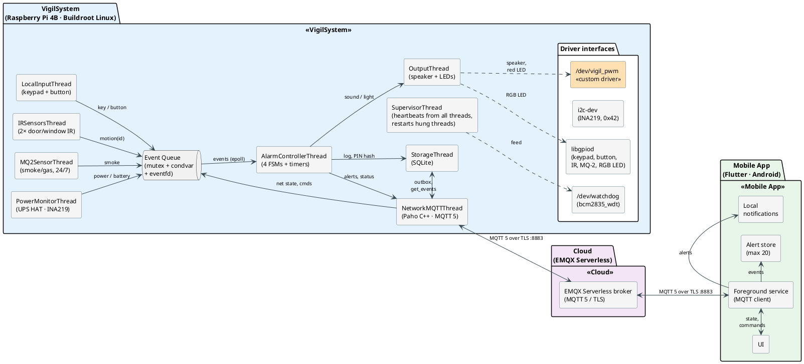

> **ARCHIVED — superseded on 2026-11-09 by `VIGILSYSTEM_MASTER_CONTEXT.md` v1.0. Kept for history only. Do not implement from this document.**
>
> Original location: Claude Project: `VigilSystem – Package Diagram (Design Phase).md` · Document date: 2 Nov 2026 · Superseded by: Master Context §E.3.
> The text below this box is an unchanged copy of the original.

---

# VigilSystem – Package Diagram (Design Phase)

Nov 2, 2026 · @David

## Purpose

The "Package diagram" slide of the design presentation (slide 33) was redrawn in PlantUML so that it matches the agreed thread architecture and the broker-only cloud. The old diagram still showed a Backend / REST API, a Cloud Database and a push-notification service, none of which exist in the design.

The diagram complements three project documents:

- **VigilSystem – MQTT Broker Selection:** EMQX Serverless as the only cloud component; Mosquitto only for tests.
- **VigilSystem – Hardware Context:** GPIO, I²C and PWM interfaces behind the driver layer.
- **VigilSystem – Mobile App GUI Design:** the Flutter app layers (foreground service, notifications, alert store, UI).

Outputs: `vigilsystem_package_diagram.puml` (source) and `vigilsystem_package_diagram.png` (rendered preview).

## Changes from the old diagram

Every change brings the slide in line with a decision already recorded in the project context.

| Old diagram | New diagram | Why |
| --- | --- | --- |
| PIRSensorsThread | IRSensorsThread | The intrusion sensors are IR reflective door/window sensors; the agreed thread name is IRSensorsThread. |
| Labels KEY\_DIGIT, KEY\_SUBMIT, CONNECTION\_LOST… | Short labels (key / button, motion(id), smoke, power / battery, net state, cmds) | Readable on a 4:3 slide; the full event names (EVT\_…) belong to the message and task slides. |
| MQ2SensorThread fed AlarmControllerThread directly and was read "on demand" | MQ2SensorThread pushes to the Event Queue | The agreed rule is one Event Queue from all producers to AlarmControllerThread. |
| No supervisor | SupervisorThread, feeding /dev/watchdog (bcm2835\_wdt) | Error-handling slide: the supervisor restarts hung threads and the watchdog resets the Pi. |
| No Storage ↔ Network link | StorageThread ↔ NetworkMQTTThread "outbox, get\_events" | PENDING\_NOTIFICATION is the outbox (PENDING before publish, SENT after PUBACK) and get\_events reads EVENT\_LOG. |
| No driver layer | Driver interfaces: /dev/vigil\_pwm «custom driver», libgpiod, i2c-dev, /dev/watchdog | Shows the single custom driver against the mainline interfaces; no Led/Keypad/Gpio/Buzzer drivers exist. |
| Cloud: MQTT Broker, Backend / REST API, Cloud Database | Cloud: EMQX Serverless broker (MQTT 5 / TLS) only | Broker-only architecture; the Pi is the source of truth. |
| Broker "triggers alerts" to a push-notification service | Broker ↔ Foreground service over MQTT 5 / TLS :8883 | No Firebase or push service; the Android foreground service holds the MQTT connection. |
| Mobile: Push Notifications, App UI / Dashboard | Foreground service, Local notifications, Alert store (max 20), UI | Matches the Flutter app layers in the GUI design document. |
| Label "TLS 1.2+", "DISCONNECT 0x04" | "MQTT 5 over TLS :8883" on both links | Same protocol and port on both sides; Last Will details stay on the MQTT specification slides. |

## Final structure

The diagram has three packages joined by two MQTT 5 / TLS links on port 8883, with all embedded logic inside the Raspberry Pi package.

&#91;image: VigilSystem package diagram\]

| Package | Components |
| --- | --- |
| «VigilSystem» (Raspberry Pi 4B · Buildroot Linux) | LocalInputThread, IRSensorsThread, MQ2SensorThread, PowerMonitorThread, Event Queue, AlarmControllerThread, OutputThread, StorageThread, NetworkMQTTThread, SupervisorThread |
| Driver interfaces (inside VigilSystem, optional) | /dev/vigil\_pwm «custom driver», libgpiod, i2c-dev (INA219, 0x42), /dev/watchdog (bcm2835\_wdt) |
| «Cloud» (EMQX Serverless) | EMQX Serverless broker (MQTT 5 / TLS) |
| «Mobile App» (Flutter · Android) | Foreground service (MQTT client), Local notifications, Alert store (max 20), UI |

| From | To | Label |
| --- | --- | --- |
| LocalInputThread | Event Queue | key / button |
| IRSensorsThread | Event Queue | motion(id) |
| MQ2SensorThread | Event Queue | smoke |
| PowerMonitorThread | Event Queue | power / battery |
| NetworkMQTTThread | Event Queue | net state, cmds |
| Event Queue | AlarmControllerThread | events (epoll) |
| AlarmControllerThread | OutputThread | sound / light |
| AlarmControllerThread | StorageThread | log, PIN hash |
| AlarmControllerThread | NetworkMQTTThread | alerts, status |
| StorageThread ↔ NetworkMQTTThread | – | outbox, get\_events |
| OutputThread | /dev/vigil\_pwm · libgpiod | speaker, red LED · RGB LED |
| SupervisorThread | /dev/watchdog | feed |
| NetworkMQTTThread ↔ broker | – | MQTT 5 over TLS :8883 |
| Broker ↔ Foreground service | – | MQTT 5 over TLS :8883 |
| Foreground service | Local notifications · Alert store · UI | alerts · events · state, commands |

## Layout decisions

The final layout is about 2.4:1, down from about 2.8:1 in the first render, so it fits the width of a 4:3 slide.

With `left to right direction`, a double dash (`-->`) puts the target in the next column and a single dash (`->`) stacks it in the same column. All layout control comes from that rule plus a few hidden links.

| Iteration | Change | Result |
| --- | --- | --- |
| 1 | Every thread linked to its driver with a dashed "uses" line; Mobile App parts in a row | Correct but about 2.8:1; long dashed lines crossed the whole Pi package |
| 2 | Removed the driver lines from the input threads; broker stacked under NetworkMQTTThread | Narrower, but the TLS link crossed StorageThread and labels overlapped |
| 3 | Broker back in its own column; Mobile App parts stacked vertically | Narrow and clean on the right; driver lines from OutputThread tangled |
| 4 | Driver layer in its own column (double-dot links); hidden links order the driver boxes | Clean driver column |
| 5 (final) | Order StorageThread → NetworkMQTTThread → SupervisorThread in one column | Storage ↔ Network link is short and straight |

Two simplifications keep the slide readable:

- **Driver users are written in the box** (for example "libgpiod (keypad, button, IR, MQ-2, RGB LED)"). Only OutputThread → /dev/vigil\_pwm and libgpiod, and SupervisorThread → /dev/watchdog, are drawn.
- **Supervisor heartbeats are stated in the SupervisorThread box** instead of eight arrows from every thread.

Colours follow the old diagram: blue for VigilSystem, purple for Cloud, green for Mobile App. The custom driver is the only orange box, so it stands out as the course's required device driver.

## Verification

Each iteration was rendered with PlantUML 1.2024.7 (Java + Graphviz `dot`) and inspected as a PNG before the next change. The source renders without errors or warnings.

Checked against the project context:

- Thread names match the agreed list exactly (LocalInputThread, IRSensorsThread, MQ2SensorThread, PowerMonitorThread, AlarmControllerThread, OutputThread, StorageThread, NetworkMQTTThread, SupervisorThread).
- All producers, including NetworkMQTTThread, push into the single Event Queue; AlarmControllerThread is its only consumer.
- Exactly one custom driver (/dev/vigil\_pwm); everything else uses libgpiod, i2c-dev or the mainline watchdog.
- Cloud contains only the EMQX Serverless broker; no backend, REST API, cloud database or push service.
- Both MQTT links are labelled "MQTT 5 over TLS :8883".

Other PlantUML or Graphviz versions can place boxes slightly differently; re-check the render after an upgrade.

## Editing the source

- **Remove the driver layer:** delete the inner `package "Driver interfaces"` block and the lines under `' --- drivers`. The rest lays out unchanged.
- **Add a box in the same column as another:** link it with a single dash or a hidden link, e.g. `NMT -[hidden]> SUP`.
- **Add a box in the next column:** use a double dash, e.g. `ACT --> NEW`.
- **Keep a box on the right when the arrow points left:** write the arrow reversed, e.g. `EQ <-- NMT` (NetworkMQTTThread stays right of the Event Queue).
- **Export for the slide:** `java -jar plantuml.jar -tsvg vigilsystem_package_diagram.puml` gives a scalable SVG; `-tpng` gives the PNG preview.

## PlantUML source

## Open points

- [ ] Replace the image on slide 33 with the new render (SVG preferred for sharpness).
- [ ] Decide whether to keep the optional driver layer on this slide or move it to the Linux Device Driver slide (slide 44).
- [ ] Check the Cloud Architecture slide (slide 19) and the system overview for the same old Backend / REST API / Cloud Database boxes.
- [ ] Decide whether the PowerMonitorThread → i2c-dev and input threads → libgpiod links should be drawn in the report version, where space is less tight.
