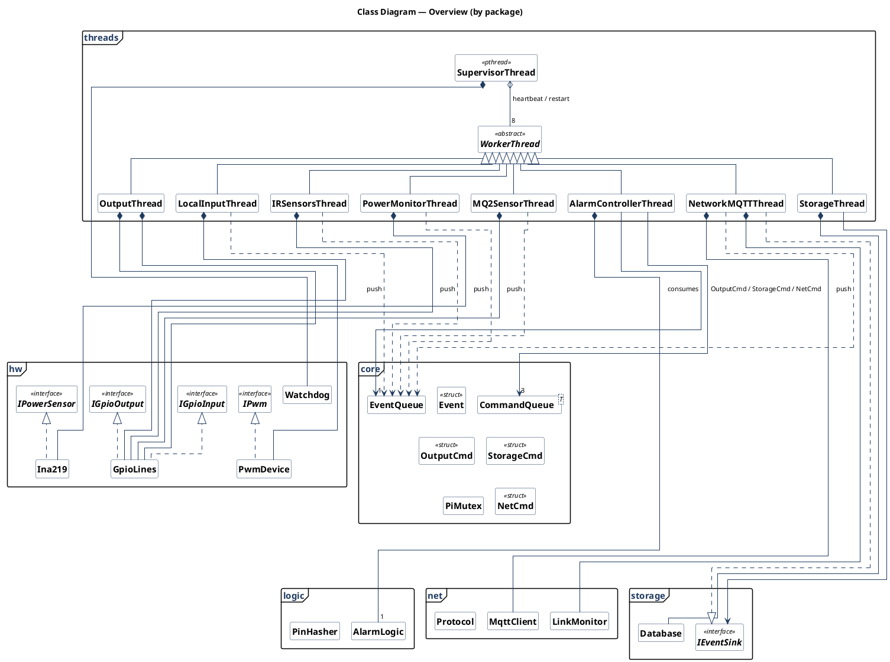
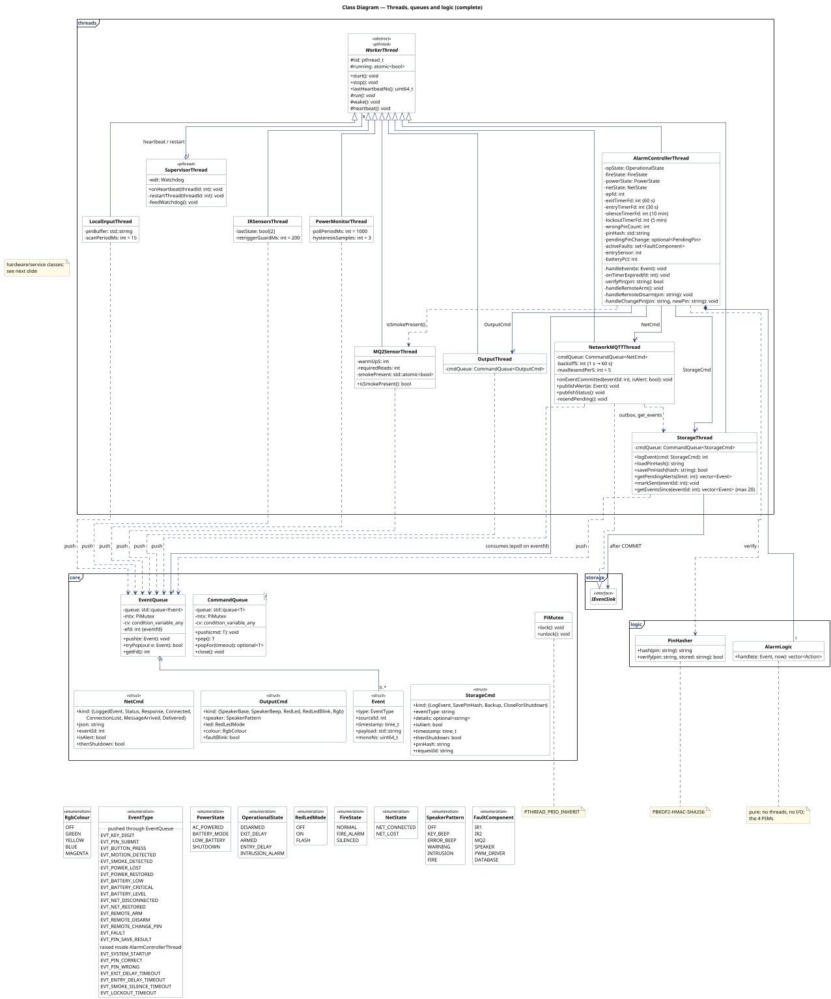
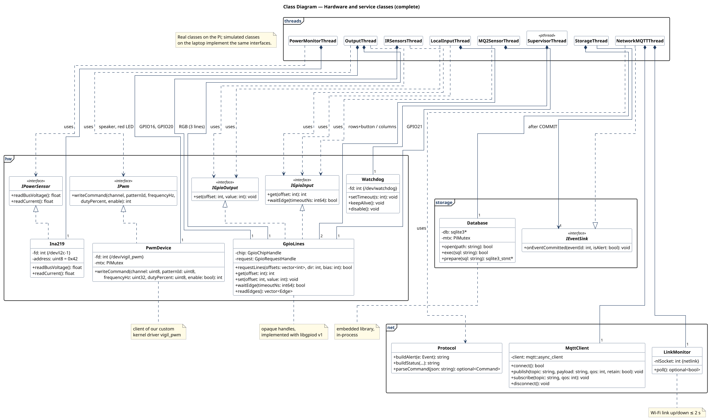

> **ARCHIVED — superseded on 2026-11-09 by `VIGILSYSTEM_MASTER_CONTEXT.md` v1.0. Kept for history only. Do not implement from this document.**
>
> Original location: Claude Project: `claude/VigilSystem – Class Diagrams for Slides (PlantUML).md` · Document date: 4 Nov 2026 · Superseded by: Master Context §E.3 (diagrams D12–D14 to be redrawn in draw.io).
> The text below this box is an unchanged copy of the original.

---

# VigilSystem – Class Diagrams for Slides (PlantUML, 3 diagrams)

Rendered with PlantUML 1.2024.7 using the ELK layout engine (`!pragma layout elk`). Orthogonal routing; no connector passes through a class box.

## Diagram 1

## Diagram 2

## Diagram 3

